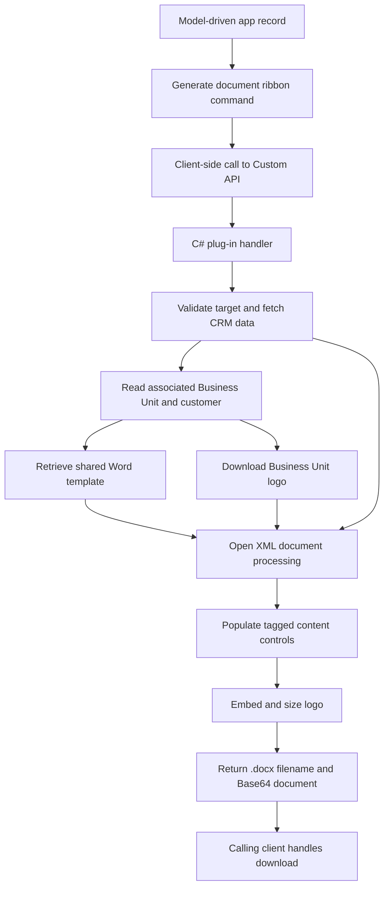

# Unified Document Template Engine for Microsoft Dynamics 365

### One shared Word template. Multiple Business Units. Dynamic branding.

**A technical case study in extending Microsoft Dynamics 365 with Dataverse, a C# plug-in, and the Open XML SDK.**

    

> **The problem:** Creating a separate, nearly identical Word template for every Business Unit does not scale. Every new unit adds another template to manage; every layout change risks becoming a repetitive update across many files.
>
> 
> **The solution:** Keep a **single shared Word template** and apply Business Unit–specific branding and CRM data **at document-generation time**.

## The challenge: template proliferation

An organization with multiple Business Units may require the same proposal structure, but with different logos and record-specific information. A Business Unit–by–Business Unit template strategy can lead to:

- Numerous copies of essentially the same Word template.
- Repeated updates when shared content or formatting changes.
- Increased maintenance effort and inconsistent versions.
- Additional administrative work when onboarding a new Business Unit.

Dynamics 365 offers native Word Template capabilities, including record-field mapping. The challenge here was **not a lack of Word document generation**. It was the maintainability of using separate templates solely to accommodate unit-specific branding. The customization addresses that particular gap; it does not imply native Word Templates have no support for related data or images.

| Conventional approach | Custom approach |
| --- | --- |
| Template A for Business Unit A | One shared template |
| Template B for Business Unit B | Logo A loaded for Business Unit A |
| Template C for Business Unit C | Logo B loaded for Business Unit B |
| Repeated changes across templates | Logo C loaded for Business Unit C |
| Template count grows with Business Units | Shared document structure remains centralized |

## Solution overview

The server-side implementation uses a Dataverse plug-in as the orchestration layer. It retrieves the CRM record and related customer details, downloads the selected Business Unit's logo from a Dataverse **File** column, obtains a Word template from the `documenttemplate` table, and uses **Open XML** to produce a branded `.docx` document.

### End-to-end architecture



**Implementation boundary:** The provided repository contains the **C# plug-in and document-processing services**. The Ribbon command, client-side invocation, and Custom API registration are part of the wider integration flow but are **not included in the provided source files**. Their names, parameters, security, and download behavior must be confirmed in the target environment.

## How document generation works

1. **Initiate generation.** A model-driven app command can invoke a Dataverse Custom API for the selected record.
2. **Validate the target.** The plug-in expects an `EntityReference` in the `Target` input parameter, verifies its logical name, and loads the required fields.
3. **Retrieve related information.** It reads the selected Business Unit and customer record, plus the document data such as date, quote number, contact, project, address, and amount.
4. **Fetch Business Unit branding.** The logo service downloads the file in blocks using `InitializeFileBlocksDownloadRequest` and `DownloadBlockRequest`.
5. **Load the shared template.** The template service looks up a specific template name from Dataverse's `documenttemplate` table and decodes its Base64 content.
6. **Build the document.** The Open XML service finds tagged Word content controls, replaces their text, embeds the downloaded logo, and scales the image while preserving its aspect ratio.
7. **Return the output.** The plug-in returns the generated Word filename in `pp_FileName` and its Base64-encoded `.docx` content in `pp_Document`.

### Document content

The supplied implementation populates these types of content:

| Document field | Data source |
| --- | --- |
| Proposal date | Current UTC date formatted for display |
| Quote number | CRM record |
| Client name and contact | Related customer record |
| Project name | CRM record |
| Site address | Customer address fields |
| Sell price | CRM money field |
| Logo | Related Business Unit's Dataverse File column |

Word fields are identified using **tagged content controls**, including tags for date, reference number, client, contact, project, address, price, and Business Unit logo. The tags are defined in the project's constants and must match those in the `.docx` template.

## Technical design

The code follows a small service-oriented design, keeping the plug-in's entry point separate from the document-specific operations.

| Component | Responsibility |
| --- | --- |
| Plug-in entry point | Validates execution context, loads records, builds proposal data, coordinates services, returns output parameters |
| `DocumentTemplateService` | Queries the `documenttemplate` table, validates uniqueness/content, decodes the template |
| `BusinessUnitLogoService` | Retrieves the Business Unit logo using Dataverse File download requests |
| `WordDocumentService` | Replaces Word content controls, inserts the logo, saves the generated document |
| Proposal data model | Stores the prepared values and logo bytes passed to the Word document service |
| Constants | Centralizes Dataverse logical names, template name, and Word content-control tags |

### Interesting implementation details

**1. Full-size image retrieval**  
A Dataverse File column requires a different retrieval pattern from an ordinary string or lookup. The logo service initializes a file download and reads the bytes in blocks (up to 4 MiB per request in the supplied implementation).

**2. Precise Word manipulation**  
The Open XML SDK opens the template as a `WordprocessingDocument`, locates structured document tags (`SdtElement`) by `Tag`, and replaces text without a Microsoft Word desktop automation dependency.

**3. Branding without cloned templates**  
The logo is embedded into the Word package as an image part. The implementation detects PNG, JPEG, GIF, or BMP data and calculates scaled dimensions with the original aspect ratio preserved.

**4. Explicit failure handling**  
The code checks for missing or duplicated templates, empty/invalid Base64 content, missing required lookups, absent Word content controls, and unsupported images, while recording plug-in trace messages.

## Technology stack

- **Microsoft Dynamics 365 / Dataverse** — CRM records, relationships, document templates, Business Unit logo storage.
- **C# / .NET Framework 4.8** — server-side plug-in logic.
- **Microsoft Dataverse SDK** — `IPlugin`, `IOrganizationService`, CRM query APIs, file download messages.
- **Open XML SDK 3.5.1** — Word package and content-control processing.
- **Visual Studio / NuGet** — solution build and dependency management.
- **Ribbon command + Custom API** — intended client-to-server integration, to be documented with its separate source/configuration.

## Running in your own environment

This repository is a **reference implementation**, not a one-click deployable package. It depends on custom Dataverse tables, columns, a Word template, the business-unit logo column, and a correctly configured plug-in/API integration.

1. Review the custom table and column logical names, template name, and content-control tags in the constants file. Replace environment-specific values with those from your own environment.
2. Create or adapt a Word `.docx` template with matching tagged content controls; upload it as a Dynamics 365 document template.
3. Configure the related Business Unit File column and supply a valid logo for each unit that should generate documents.
4. Open the Visual Studio solution and restore the NuGet packages (the project targets **.NET Framework 4.8**).
5. Build and register the plug-in assembly and associate the appropriate plug-in handler with the Custom API in Dataverse. Validate the actual registration and parameter contract in your environment.
6. Configure your Ribbon command and client invocation to call the Custom API, pass the target record reference, and handle the returned filename and Base64 content.
7. Test generation using sample, non-sensitive records from multiple Business Units.

**Required plug-in contract visible in source**

```text
Input:
  Target       EntityReference

Output:
  pp_FileName  string (.docx filename)
  pp_Document  string (Base64-encoded Word document)
```

The supplied code does not establish a complete public Custom API definition or provide the Ribbon JavaScript. Do not assume those components are deployable from this repository alone.

## Suggested validation scenarios

- Generate documents for two or more Business Units with different logos.
- Confirm that the **same shared Word template** is used while the branding differs appropriately.
- Confirm that the expected fields and address are populated correctly.
- Verify logo dimensions and aspect ratio in Word.
- Test missing Business Unit/customer relationships and missing logo files.
- Test an absent or duplicate named document template.
- Test a malformed template, unsupported image format, or missing content-control tag.
- Confirm the caller correctly decodes and downloads the returned document.

## Outcome

The implementation demonstrates a way to **centralize common Word document structure** while applying Business Unit–specific branding at runtime. It avoids maintaining separate templates merely to change logos and keeps the solution's retrieval, transformation, and generation logic in dedicated services.

No measured time savings, production usage statistics, or performance benchmarks are claimed here. The benefit is architectural: reduced template duplication and a clearer maintenance model for a multi–Business Unit scenario.

## Security and publishing notes

> **Important:** Review the repository before making it public or sharing it with clients. The uploaded project contains a `.snk.pfx` assembly-signing file. Treat it as potentially sensitive private-key material: remove it from public tracking, assess whether it needs rotation/replacement, and review Git history because deleting it in a new commit does not erase older copies. Also review business-specific names, identifiers, and proprietary code before publication.

This project uses example-friendly descriptions in this README. Repository source names and configuration may still contain environment-specific or organization-specific identifiers.

---

### Engineering takeaway

> **The best customization is not always a bigger application. Sometimes it is a focused extension that removes duplication from an existing business process.**

**Interested in Dynamics 365, Dataverse, plug-in development, or document automation?** Feel free to connect through my [GitHub profile](https://github.com/PGPradhan).
